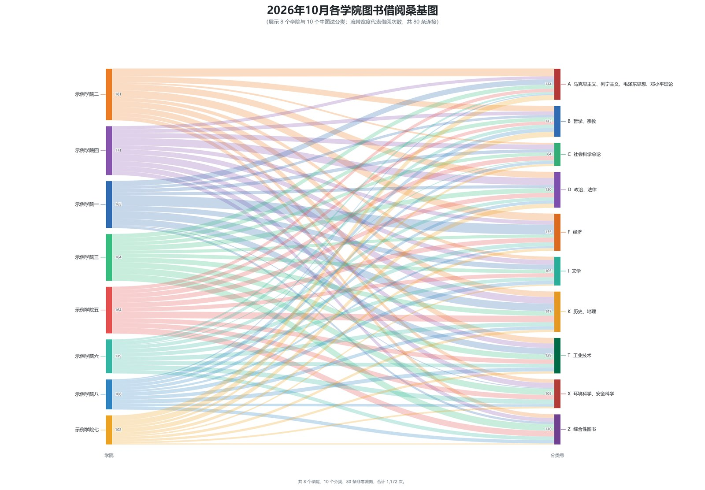

# Book Borrowing Sankey

一个可复用的 WorkBuddy Skill 和命令行工具，用图书馆每月导出的“文献分类借还统计”Excel 自动生成 **学院 → 中图法分类** 桑基图。



> 上图使用完全合成的示例数据，不包含任何真实院校或借阅数据。

## 功能

- 自动读取一个目录下的多个学院 Excel，聚合为“学院 × 分类”流量矩阵。
- 动态识别表头，不依赖固定行号。
- 保留原始分类名称、分类号和顺序，不擅自改名或合并分类。
- 校验日期字段、非负整数、各院合计、分类合计和月份一致性。
- 支持一个学院导出为空表时，根据全校汇总与其余学院差额确定性恢复。
- 输出高分辨率 PNG、可编辑 SVG，以及包含全部零值的学院 × 分类 CSV。
- 图表为单栏白底，学院按总量降序排列；分类保持源表顺序。

## 安装为 WorkBuddy Skill

将仓库放入用户级 Skill 目录：

```bash
git clone https://github.com/Mongo-MGMAX/book-borrowing-sankey.git ~/.workbuddy/skills/book-borrowing-sankey
```

Windows PowerShell：

```powershell
git clone https://github.com/Mongo-MGMAX/book-borrowing-sankey.git "$HOME\.workbuddy\skills\book-borrowing-sankey"
```

安装后在 WorkBuddy 中提到“图书借阅桑基图”“学院借阅流向”或“图书馆月度报表”即可触发。

## 安装依赖

```bash
pip install -r requirements.txt
```

中文字体建议使用 Microsoft YaHei、SimHei、Noto Sans CJK SC 或 Source Han Sans SC。

## 输入格式

准备一个目录，每个学院一个 `.xlsx` 文件：

```text
college-data/
├── 学院甲.xlsx
├── 学院乙.xlsx
└── 学院丙.xlsx
```

每个工作簿应来自图书馆“文献分类借还统计”导出，包含：

- 前几行统计条件，包含 `借阅时间：YYYY-MM` 和 `院系：学院名称`
- 表头字段：`序号`、`分类名称`、`分类号`
- 日期字段：`1日(次数)` 到 `31日(次数)`
- 每个中图法分类一行

可选提供全校汇总表，用于全量校验或恢复单个空表：

```text
2026年10月各学院图书借阅统计.xlsx
```

详细字段、校验顺序和恢复算法见 [references/input-format.md](references/input-format.md)。

## 使用

```bash
python scripts/generate_sankey.py \
  --input ./college-data \
  --reference ./2026年10月各学院图书借阅统计.xlsx \
  --output-dir ./output
```

常用参数：

| 参数 | 说明 |
|---|---|
| `--input` | 学院 Excel 目录，必填 |
| `--reference` | 全校汇总 Excel，可选 |
| `--output-dir` | 输出目录，默认 `./sankey-output` |
| `--output-prefix` | 自定义输出文件名前缀 |
| `--title-suffix` | 图表标题后缀 |
| `--min-college` | 学院总量显示阈值 |
| `--min-link` | 学院—分类流量显示阈值 |
| `--dpi` | PNG 分辨率，默认 200 |
| `--show` | 同时打开 Matplotlib 窗口 |

## 输出

```text
output/
├── 各学院图书借阅桑基图_2026年10月.png
├── 各学院图书借阅桑基图_2026年10月.svg
└── 各学院图书借阅桑基图_2026年10月_流向明细.csv
```

CSV 包含所有学院 × 分类组合，包括零值，并记录学院总量和数据状态。

## 数据安全策略

- 不修改原始 Excel。
- 分类名称、分类号、学院名称和月份均以源文件为准。
- 多个空学院文件无法可靠分摊时直接报错，不猜测。
- 单个空学院文件只有在全校汇总减其余学院后每格均非负时才恢复。
- 恢复的学院和金额会写入图表页脚、CSV 和终端输出。
- 馆藏借阅合计与分类明细之间的差额只披露、不摊派。

## 自检

运行合成数据冒烟测试：

```bash
python scripts/smoke_test.py
```

测试覆盖 Excel 解析、空表恢复、总量校验、PNG/SVG/CSV 输出，不依赖真实数据。

## 隐私

请勿向公共仓库提交真实图书馆工作簿、生成的流向 CSV 或包含机构数据的图表。仓库中的预览图使用合成数据。

## License

[MIT](LICENSE)
